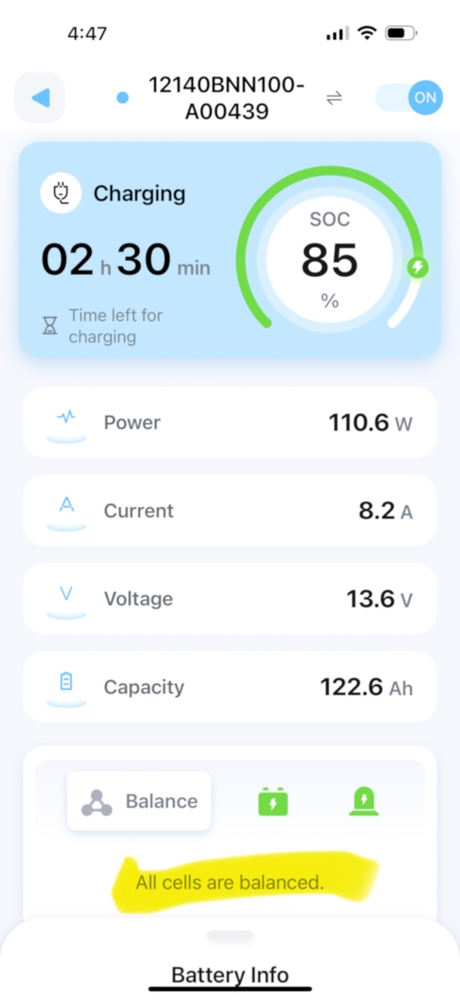

# 031 — Триваліша авторизація та візуальне покращення інтерфейсу

Дата: 13.11.2026.
Статус: Реалізовано й перевірено локально 13.11.2026. [Звіт, результати та скриншоти](../testing/031-session-and-visual-polish/README.md). Hosted Supabase і production-деплой не змінювалися.

## Мета

Прибрати часті повторні входи, спростити початковий вигляд login, зробити фінансові показники виразнішими та оновити оформлення застосунку за наданим референсом. Зберегти всі наявні секції, їхні деталі, дані та функції; зміни структури обмежити згортанням секції входу й адаптивним розташуванням елементів.

Контекст: [авторизація 001](001-authentication.md), [візуальні правки 014](014-visual-refinements.md), [облік витрат 019](019-shopping-workflow-improvements.md), [мобільна авторизація 023](023-mobile-authentication.md). Перед реалізацією прочитати актуальну документацію Supabase Auth/SSR, документацію проєкту та відповідні AGENTS.md.

## 1. Тривалість авторизації

- З'ясувати причину частих повторних входів: строк access token, оновлення refresh token, збереження cookie, серверне оновлення сесії та налаштування Supabase. Виправити механізм збереження й автоматичного оновлення сесії та, за потреби, збільшити відповідні строки.
- Ціль: користувач не повинен повторно авторизовуватися через звичайне завершення строку access token, перезавантаження сторінки, закриття/відкриття браузера або повернення до застосунку за чинної сесії. Конкретний строк сесії зафіксувати в документації реалізації після перевірки поточних налаштувань; користувач його не задав.
- Не обмежувати виправлення збільшенням JWT TTL, якщо причина в refresh/cookie. Зберегти явний вихід, обробку відкликаної сесії та перевірку доступу до просторів.
- Перевірити вебсесію; якщо зміна зачіпає спільні налаштування Auth, перевірити також сумісність із мобільним клієнтом 023. Окремо зазначити потрібні зміни hosted-конфігурації та фактично перевірені сценарії.

## 2. Login: згорнутий «Спільний простір»

- На початковому відкритті сторінки входу секція «Спільний простір» згорнута; її назва й індикатор розгортання залишаються видимими.
- Натискання на заголовок розгортає секцію, повторне — згортає. Усі нинішні деталі та дії залишаються всередині.
- Використати доступну кнопку з `aria-expanded` та `aria-controls`, підтримати клавіатуру й видимий фокус. Приховані елементи не потрапляють у tab-послідовність.
- Не втрачати введені дані при згортанні й не порушити чинний сценарій переходу за запрошенням.

## 3. Витрати: план, факт, економія та колір ціни

- Перевірити правильність плану, факту й економії відповідно до 019: план — незмінний знімок, факт — повна фактична сума покупки, різниця = план − факт. Повторно на кількість факт не множити.
- Зробити числа виразнішими за підписи: чітка типографічна ієрархія, достатній розмір і вага, читабельна валюта, узгоджене форматування. Зберегти підсумки місяця/фільтра та деталі кожної покупки.
- Після коригування факту цінник зелений, якщо факт нижчий за план, і червоний, якщо вищий. За рівності — нейтральний. Повторні корекції порівнювати з тим самим початковим планом, а не з попередньою корекцією.
- Доповнити колір текстом «Економія» / «Перевитрата» та сумою різниці; колір не є єдиним способом зрозуміти стан.
- Приклади: план 300 грн, факт 250 грн → зелений цінник, економія 50 грн; факт 350 грн → червоний, перевитрата 50 грн; факт 300 грн → нейтральний, різниця 0 грн.
- Невідомий історичний план не вважати нулем: залишити нейтральний цінник і пояснення про відсутність даних для порівняння. Зберегти охоплення порівняння зі змішаними історичними даними.

## 4. Статистика на вузьких екранах

- Виправити накладання великої суми на кільцеву діаграму. Для вузького екрана передбачити достатнє окреме місце для повної суми та валюти, за потреби перенести їх над діаграмою.
- Не обрізати значення й не ховати розряди заради вміщення. Підписи, легенда, коло та інші елементи не перекриваються й не спричиняють горизонтального прокручування сторінки.
- Перевірити ширини 320, 360, 390 і 768 px та desktop, зокрема значення `9 999 999,99 грн`, нуль і порожній стан. Перевірити збільшення тексту до 200%.
- Зберегти чинний контракт спільного snapshot для суми, категорій і діаграми; візуальні правки не змінюють підрахунок.

## 5. Налаштування та спільний стиль

- Прибрати жорсткі контрастні декоративні бордери з усіх секцій налаштувань і узгодити це оформлення в усьому застосунку.
- Відділяти секції м'якими поверхнями, відступами, округленням і делікатними тінями або малоконтрастними межами, де вони потрібні для читабельності.
- Зберегти помітний клавіатурний фокус, стани помилки, вибору й недоступності, а також розпізнаваність полів і кнопок.
- Провести правки через наявні стилі/токени, перевірити всі шість поточних тем, включно з темною. Не встановлювати непотрібних бібліотек.

## 6. Візуальний референс і збереження деталей

Референс користувача: [оригінальний скриншот](../design/031/reference.jpg).

- Орієнтири: світлий нейтральний фон, просторі округлі картки, м'які тіні, делікатні кольорові акценти, спокійні підписи та виразні числові значення. Адаптувати ці принципи до поточної теми й змісту Shopik.
- Після попередніх правок узгодити відступи, заголовки, іконки, радіуси, кнопки та щільність секцій на login, витратах, налаштуваннях та інших основних екранах.
- Не копіювати зміст батарейного застосунку, жовте виділення або сторонні елементи зі скриншота. Не замінювати наявні секції спрощеними макетами й не видаляти їхні деталі чи дії.
- Перед змінами зафіксувати перелік секцій і станів екранів; після змін звірити їхню наявність та функціональність.

## Перевірки та критерії завершення

- Усі шість пунктів реалізовані; наявні секції, поля, дані, дії та вибір тем збережені.
- Виконані доступні перевірки TypeScript, lint і production build; профільні тести авторизації та розрахунків витрат. Нові тести додавати для змін логіки й регресій, а не для дублювання CSS.
- Перевірені оновлення сесії після завершення access token, reload/reopen, повернення з фону та logout; справжні перевірки Auth відокремлені від тестів із підставними даними.
- Перевірені згортання login мишею/клавіатурою, нижчий/вищий/рівний/невідомий план, повторне коригування факту, місячні підсумки й фільтри.
- Візуально перевірені вузькі екрани, великі суми, всі теми, focus/error/disabled стани та збереження деталей секцій.
- Результати й обмеження перевірок, зміни строків авторизації та порівняння вигляду до/після записати в `docs/testing/031-session-and-visual-polish/README.md` під час реалізації.

Реалізація зберігає наявний строк cookie Supabase SSR — 400 днів. Виправлено оновлення сесії на API-маршрутах і помилкову втрату доступу при тимчасовому збої перевірки членства; строк JWT та hosted-обмеження сесій не змінювалися. Деталі й межі перевірок наведені у звіті.
